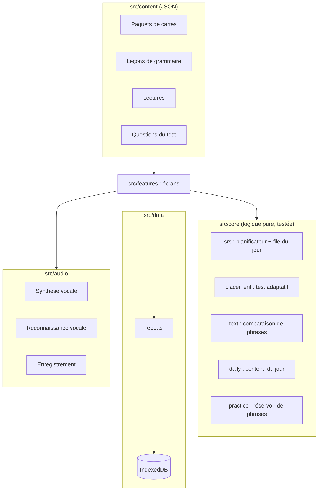

# Architecture

## Principes

- **Hors ligne et sans compte.** Application statique (HTML, CSS, JS) servie par n'importe quel hébergeur ; les données vivent dans IndexedDB.
- **Logique pure séparée de l'interface.** Tout ce qui décide (quand revoir une carte, quel niveau recommander, comment noter une dictée) est dans `src/core/`, sans dépendance au navigateur, et testé avec le lanceur de tests intégré à Node (`node --test`).
- **Contenu en données.** Cartes, leçons, lectures et questions du test sont des fichiers JSON validés par les tests. Enrichir l'application ne demande pas de toucher au code des écrans.
- **Peu de dépendances.** React pour l'interface ; routeur, accès à la base et planificateur sont écrits dans le projet (quelques centaines de lignes au total).

## Vue d'ensemble

## Modèle de données (IndexedDB, base `italiano`)

| Magasin | Clé | Contenu |
| --- | --- | --- |
| `kv` | nom | `profile` (niveau, date, résultat du test), `settings` (voix, débit, nouvelles cartes par jour), `activeDays` (jours pratiqués) |
| `cards` | id de carte | état de répétition : phase, étape, facilité, intervalle, échéance, nombre de révisions et d'oublis |
| `reviews` | auto | journal de chaque réponse à une carte ; index `day` et `cardId` |
| `attempts` | auto | résultats d'exercices (grammaire, lecture, dictée, oral) sur 100 ; index `day` et `kind` |
| `userNotes` | id | mots ajoutés par la personne |

Une **note** de vocabulaire produit deux **cartes** : `<note>::rec` (italien → français) et `<note>::prod` (français → italien). La carte de production n'est proposée qu'une fois la reconnaissance acquise.

Pour modifier le schéma : incrémenter `DB_VERSION` dans `src/data/db.ts` et ajouter une étape de migration `if (oldVersion < N)`.

## Répétition espacée

`src/core/srs/scheduler.ts` reprend le fonctionnement d'Anki (SM-2) :

- **Apprentissage** : étapes de 1 puis 10 minutes ; « Correct » passe à l'étape suivante, la dernière étape donne un intervalle d'un jour, « Facile » donne directement 4 jours.
- **Révision** : l'intervalle est multiplié par la facilité (250 % au départ). « Difficile » ×1,2 et facilité −15 points ; « Facile » bonus ×1,3 et facilité +15 points ; un retard est en partie crédité.
- **Oubli** : facilité −20 points, réapprentissage de 10 minutes, l'intervalle repart à un jour.
- Les jours basculent à 4 h du matin.

Tous les paramètres sont regroupés dans `DEFAULT_CONFIG`. Pour passer à FSRS, il suffit de fournir une autre fonction `schedule(card, grade, now)`.

## Test de niveau

`src/core/placement/engine.ts` : départ en A2, blocs de quatre questions par niveau dont au moins une d'écoute. Bloc réussi à 75 % : on monte ; sous 50 % : on descend ; entre les deux : on s'arrête. Le niveau recommandé est le premier niveau non maîtrisé. De 4 à 16 questions selon le parcours.

## Audio

- **Écoute** (`tts.ts`) : API Web Speech, voix italienne de l'appareil, débit réglable, découpage par phrases (Chrome coupe les énoncés trop longs).
- **Oral** (`stt.ts`) : reconnaissance vocale du navigateur en `it-IT`, trois transcriptions candidates, on garde la plus proche de la phrase attendue.
- **Enregistrement** (`recorder.ts`) : MediaRecorder ; l'audio reste en mémoire.

## Interface

- Routeur à base de fragment d'URL (`#/grammaire/a1-articoli`) : aucun réglage serveur nécessaire.
- `useLive()` recharge les données d'un écran dès qu'une écriture a lieu en base.
- Identité visuelle : le parcours A1 → C1 dessiné comme une ligne de métro ; chaque activité a sa couleur de « ligne » (cartes rouge, grammaire vert, lecture jaune, dictée bleu, oral lilas). Texte italien en Palatino.
- Service worker (`public/sw.js`) : réseau d'abord pour la page, cache d'abord pour les fichiers compilés.
